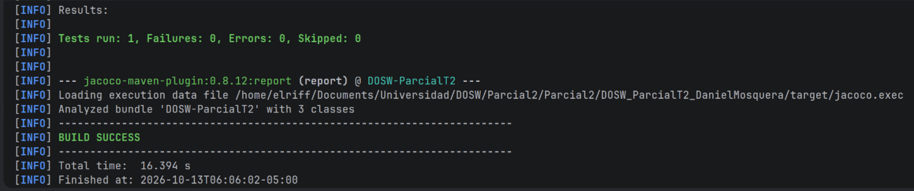
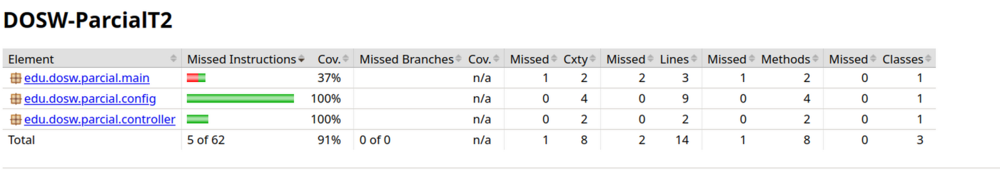
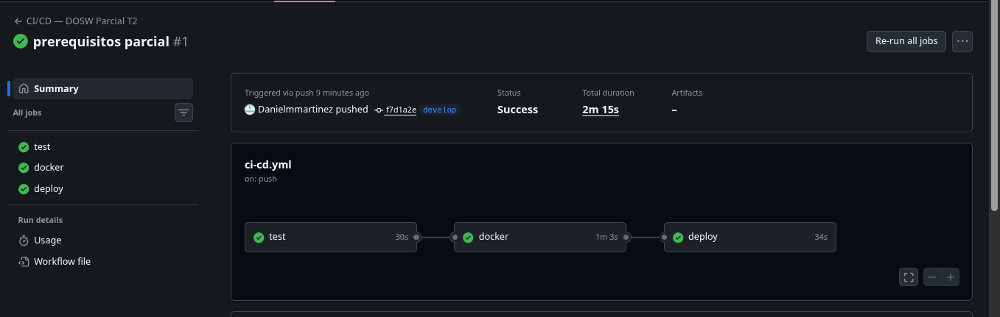

# DOSW_ParcialT2_DanielMosquera

* **Integrantes Pareja** Daniel Camilo Mosquera Martinez, Juan Manuel Garzon 
* **Color:** VERDE

| Módulo         | Método  | Endpoint                              | Idempotencia | Acceso           | Validaciones de entrada                                          | Validaciones de Negocio                                                                                                                                    | Datos de Entrada                                                                                                                                                                                                                                                         | Ejemplo de entrada                                | Datos de Salida                                                                                                 | Ejemplo de Salida                   |
|:---------------|:--------|:--------------------------------------|:-------------|:-----------------|:-----------------------------------------------------------------|:-----------------------------------------------------------------------------------------------------------------------------------------------------------|:-------------------------------------------------------------------------------------------------------------------------------------------------------------------------------------------------------------------------------------------------------------------------|:--------------------------------------------------|:----------------------------------------------------------------------------------------------------------------|:------------------------------------|
| **Auth**       | `POST`  | `/api/v1/auth/login`                  | No           | Adoptante, Admin | El correo tenga el formato correcto                              | El administrador y los adoptantes son usuarios predefinidos                                                                                                | correo (text, Obligatorio), contraseña (text, Obligatorio)                                                                                                                                                                                                               | Daniel@gmail.com, Constraseña124                  | Token JWT (Text)                                                                                                | ñakdjfñañakjrbñ!q                   |
| **Adopcion**   | `GET`   | `/api/v1/adopciones/solicitudes/{id}` | Si           | Adoptante, Admin |                                                                  | El id de la solicitud                                                                                                                                      | idSolicitud (text, Obligatorio)                                                                                                                                                                                                                                          | 12                                                | nombre (text, Obligatorio), especie (enum, Obligatorio), edad (numero, Obligatorio), tamano (enum, Obligatorio) | algo                                | 
| **Adopcion**   | `POST`  | `/api/v1/adopciones/solucitudes`      | No           | Adoptante        | Fecha entre 1 y 15 dias a partir de hoy                          | <ul><li>La mascota debe estar disponible</li> <li>un adoptante solo puede tener una solicitud activa, <li>condiciones compatibles con la mascota</li></ul> | idMascota (text, Obligatorio), fechaRecibimiento (fecha, Obligatorio)                                                                                                                                                                                                    | 12, 10/13/2026                                    | idSolicitud (text), EstadoSolicitud (text)                                                                      | algo                                |
| **Adopcion**   | `PATCH` | `/api/v1/adopciones/solicitudes/{id}` | Si           | Adoptante        | Fecha posterior a la actual y no superar los 15 dias adicionales | La solicitud debe estar aprobada, maximo un aplazamiento por solicitud                                                                                     | idSolicitud (text, Obligatorio), fechaRecibimiento (fecha, Obligatorio)                                                                                                                                                                                                  | 12, 10/14/2026                                    | idSolicitud (text), fechaNuevaRecibimiento(fecha)                                                               | algo                                |                                                                                                                                                                                                                                                            
| **Mascotas**   | `POST`  | `/api/v1/mascota`                     | No           | Admin            | Edad entre 0 y 360 dias,                                         | Refugio debe existir y ser tipo refugio, y la mascota nace disponible                                                                                      | nombre (text, Obligatorio), especie (enum, Obligatorio), edad (numero, Obligatorio), tamano (enum, Obligatorio), ninos (boolean, Obligatorio), otrasMascotas (boolean, Obligatorio), espaciosReducidos (boolean, Obligatorio), refugio (text, Obligatorio), estado(enum) | Max, PERRO, 24, MEDIANO, SI, SI, SI, Norte-Bogota | idMascota(text), estado(enum)                                                                                   | LGO                                 | 
| **Mascotas**   | `GET`   | `/api/v1/mascota?estado=adoptado`     | Si           | Adoptante, Admin |                                                                  |                                                                                                                                                            | `{   }`                                                                                                                                                                                                                                                           |                                                   | idMascota(text), fechaAdopcion(fecha)                                                                           | A                                   |                   |
| **Adoptantes** | `PATCH` | `/api/v1/adoptantes/{id}`             | Si           | Adoptante        |                                                                  | El adoptante debe existir                                                                                                                                  | id(text, Obligatorio), niños(boolean), otrasMascotas(boolean), espaciosReducidos(boolean)                                                                                                                                                                                | 1, true, true, false                              | id(text, obligatorio), mensaje(text, Obligatorio)                                                               | 1, "Cambio realizado correctamente" |
## Preguntas de Revision
* **a. ¿Cuál es la diferencia entre una validación de entrada y una validación de negocio? Seleccionen tres reglas del caso, incluyendo al menos una de cada tipo, y justifiquen su clasificación.**
  *  La diferencia principal es que la validacion de entrada se enfoca en el valor ingresado, y la validacion de negocio se enfoca en las reglas de negocio.
* **b.	En crear solicitud, ¿cómo debe responder la API si fallan varias condiciones? Expliquen qué error se informa y qué cambios deben evitarse.**
  * No debe permitir que los datos erroneos entren a la base de datos y debe informar que valores estan erroneos

* **URL Base en Azure:** https://dosw-parcial2-danielmosquera.azurewebsites.net
* **URL Health Check:** [https://dosw-parcial2-danielmosquera.azurewebsites.net/api/v1/health](https://dosw-parcial2-danielmosquera.azurewebsites.net/api/v1/health)
* **URL Swagger UI:** [https://dosw-parcial2-danielmosquera.azurewebsites.net/swagger-ui/index.html](https://dosw-parcial2-danielmosquera.azurewebsites.net/swagger-ui/index.html)

# Construir la imagen local
docker build -t dosw-parcial:local .

# Ejecutar el contenedor
docker run -d -p 8080:8080 \
-e JWT_SECRET="dGhpc0lzQVZlcnlTZWN1cmVTZWNyZXRLZXlGb3JKV1RUb2tlbnNPbmx5Rm9yRGV2MQ==" \
--name dosw-servicio dosw-parcial:local

Resultado de las pruebas en verde:

Reporte de cobertura generado por JaCoCo (target/site/jacoco/index.html):

Pipeline en GitHub Actions en verde:

